# The native core: what changed from 0.2.1 to 0.3.0

0.3.0 replaces the C++ backend of 0.2.1 (one template class per spline family,
wrapped by Python) with one native core that all spline types share. This is a
map of that core, in diagrams.

Contents: [layers](#1-layers) · [one call](#2-one-call-python--c--python) ·
[create and change](#3-creating-and-changing-a-spline) ·
[data model](#4-data-model) · [rational](#5-rational-splines-weights-on-the-fly) ·
[memory](#6-memory-buffers-arenas-workspace) · [threads](#7-threads) ·
[queries](#8-the-query-path) · [axis maps](#9-changing-the-basis-axismap) ·
[hierarchy](#10-hierarchical-splines-hb--thb) · [file map](#11-where-to-look)

## 1. Layers

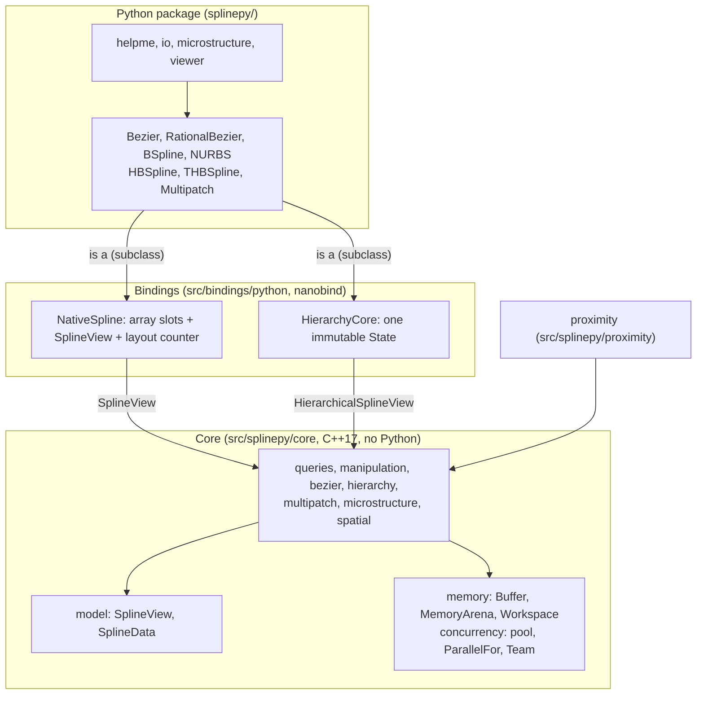

- The Python spline **is** the native object (it subclasses it). There is no
  wrapper and no second copy of the data.
- The core knows nothing about Python. It takes views (pointers and sizes)
  and returns owned data.

## 2. One call: Python → C++ → Python

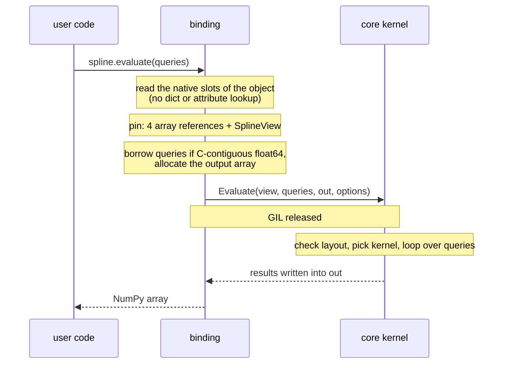

When the result is a spline (`compose`, `split`, `insert_knots` copies,
`extract_bezier_patches`, ...):

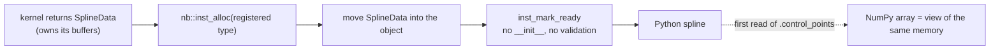

- The classes are registered once at import (`_core._register_types`), so
  C++ creates the right Python type without running Python code.
- NumPy arrays of a result are made only when asked for; `para_dim`, `dim`,
  `is_rational` are read from the view.

## 3. Creating and changing a spline

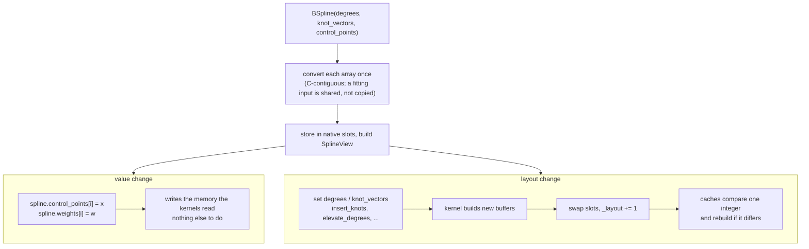

- **Layout** = degrees, knots (and for a hierarchy: levels, leaves, active
  functions). **Values** = control points and weights.
- Caches depend on layout only. That is why degrees and knot vectors are
  read-only arrays: an in-place edit could not bump the counter. Knots change
  through `KnotVector` methods or `with spline.edit_knot_vectors()`.
- Arrays the user already holds stay valid after a swap (NumPy reference
  counts keep the old memory alive).

## 4. Data model

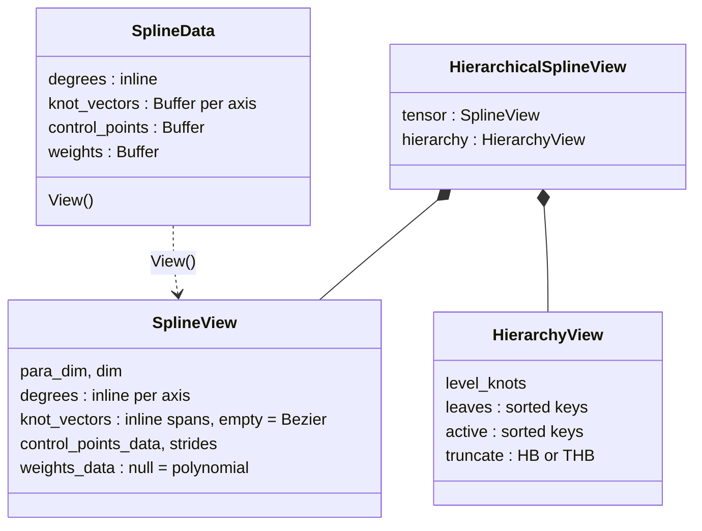

| | owns memory | used for |
|---|---|---|
| `SplineView` | no (trivially copyable, no heap) | input of every tensor kernel |
| `SplineData` | yes (`Buffer`s that never move) | results, batches (`Buffer<SplineData>`) |
| NumPy arrays in the native slots | yes (NumPy) | a spline built from Python |
| `HierarchicalSplineView` | no | input of hierarchy functions |

One view type covers the four tensor families. The family follows from the
data:

| | no knot vectors | knot vectors |
|---|---|---|
| no weights | Bezier | BSpline |
| weights | RationalBezier | NURBS |

No virtual functions, no template per (para_dim, dim). A kernel takes
`const SplineView&`; Bezier-only algebra starts with `ThrowIfNotBezier`.
Tensor kernels cannot be handed a hierarchy, because it is a different type.

### Then and now

| | 0.2.1 | 0.3.0 |
|---|---|---|
| C++ spline | class per family, templates instantiated for para_dim 1–10, virtual `SplinepyBase` | one `SplineView` for all, kept next to the arrays |
| Python state | `_data` dict, a copy of what C++ holds | native slots, no dict |
| change | `_new_core`: rebuild the C++ object | swap a slot, bump `_layout` |
| NURBS storage | C++ homogeneous copy + Python control points and weights, kept in sync (`PhysicalSpaceArray`) | control points and weights, combined per query |
| result spline | new Python object through `__init__` | `inst_alloc`, data moved in |
| threads | new `std::thread`s per call | one pool, count from the work |
| scratch | allocations inside the call | per-thread arenas, reused |
| hierarchical splines | none | HB and THB on the same kernels |

What makes it faster: a small call is almost only the kernel, with no dict
lookups, no `__init__` and no second validation around it. Large calls gain
from the fast kernels, the pool and the arenas.

## 5. Rational splines: weights on the fly

Stored: plain control points `P` and weights `w`. Nothing homogeneous is
stored, so there is nothing to keep in sync.

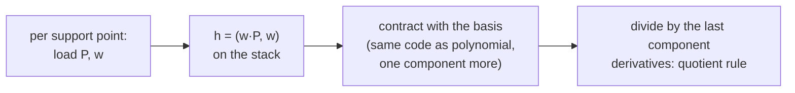

- "Rational" is a compile-time flag of the kernel, chosen by one branch on
  `weights_data != nullptr`.
- A weight that is not positive becomes NaN, so bad input shows as a
  non-finite result; only then the supports are searched for the value to
  report (no check before the kernel).
- Bezier algebra (`add`, `multiply`, `derivative_spline`, `compose`) works on
  the homogeneous net `(N, W)` through polynomial views of existing buffers,
  not through intermediate splines.

## 6. Memory: buffers, arenas, workspace

Three kinds of memory, by lifetime:

| kind | type | lifetime | note |
|---|---|---|---|
| stored / handed out | `Buffer<T>` | the object | fixed size, never moves, not zeroed, so spans and NumPy views stay valid |
| being built | `DynamicBuffer<T>` | until `Finish()` | grows ×2, then becomes a `Buffer` |
| scratch | `MemoryArena` | one kernel call | bump allocator; a `Scope` resets it on return |
| tiny scratch | `ScratchArray<T, N>` | one function | stack up to N, else heap |

No `std::vector` in the core.

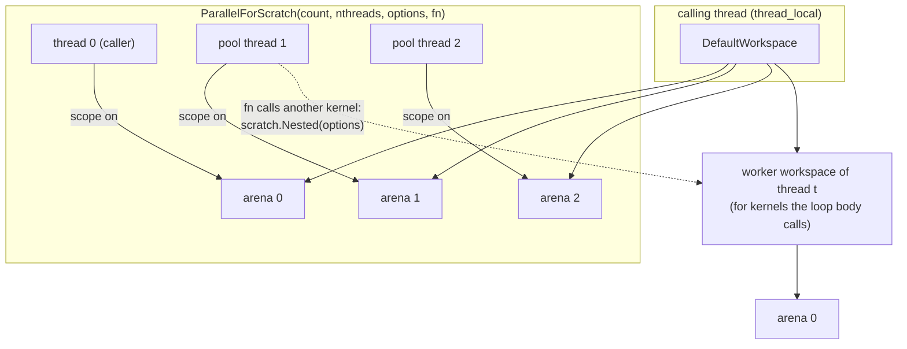

How it works:

1. A kernel asks for a workspace: `options.workspace` if the caller gave one,
   else the calling thread's default workspace (created once per thread).
2. The workspace is grown to one arena per thread **before** workers start.
3. Thread `t` allocates only from arena `t`. No locks, no sharing.
4. Each loop body runs inside an arena scope: what it allocated is released
   when it returns, but the blocks stay, so the next call allocates nothing
   from the OS.
5. A kernel always uses arena 0 of the workspace it is given. A loop body
   that calls another kernel therefore passes its thread's own worker
   workspace (`scratch.Nested`), single threaded and without validation.

`ParallelForScratch` is the one place that pairs threads with arenas.

## 7. Threads

### From "n threads per call" to a pool with a work rule

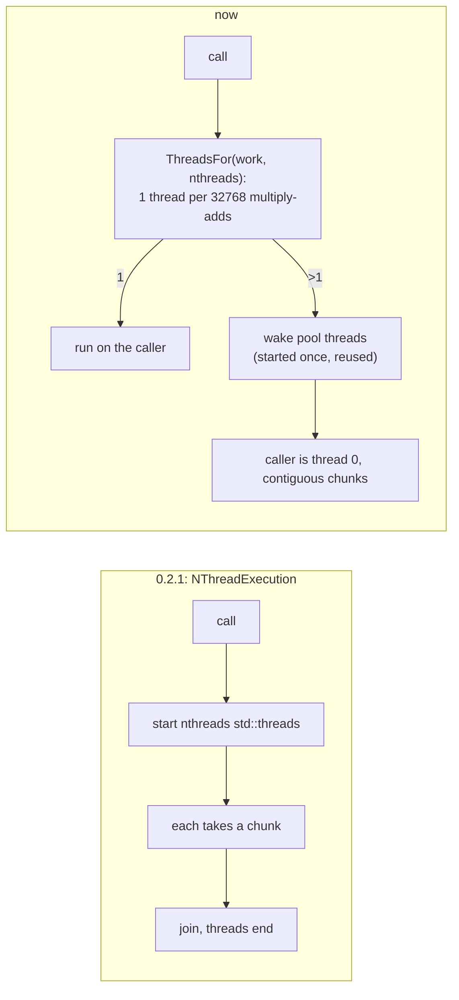

| piece | what it does | where it helps |
|---|---|---|
| process-wide pool (`RunOnThreads`) | threads start once; a call costs a wake-up instead of about 22 µs for starting 4 threads | every threaded call that is not huge |
| `ThreadsFor(work, nthreads)` | small work stays on the caller, however many threads were asked for | `nthreads=-1` as a safe default: 1 query or 10⁶ |
| no nesting | a kernel inside a parallel loop is single threaded (`WorkerOptions`) | batches of splines, hierarchy and proximity loops |
| pool busy → run alone | a second caller does not wait or share workers | calls from several Python threads |
| first exception rethrown on the caller | errors behave the same with 1 or n threads | all |
| `ParallelForChunks` | contiguous chunks, at most one per thread | queries (output is contiguous per chunk) |
| `Team` / `RunTeam` | threads woken once, meet at a barrier between stages | compose batches (below) |

Threaded and serial runs give bit-identical results.

### Where the extra machinery pays: compose batches

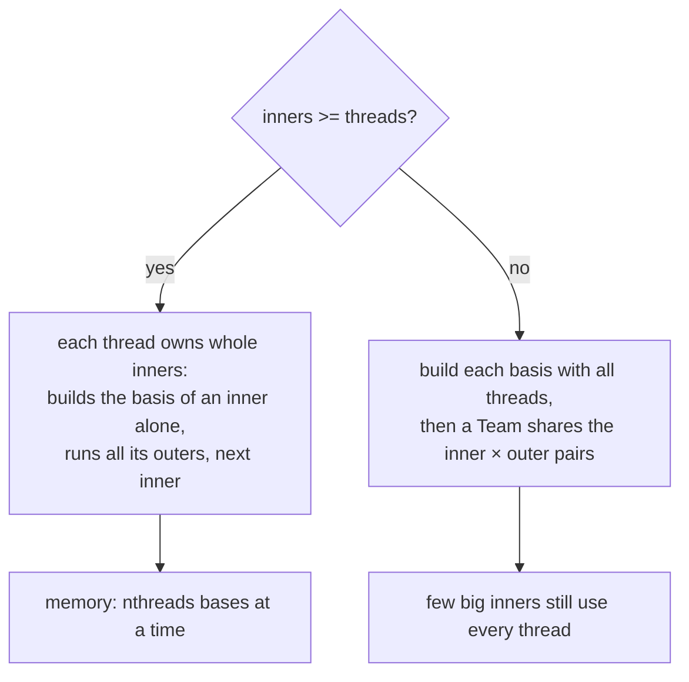

This is the microstructure case (many tiles into one deformation function,
or few into many). A flat "chunk the batch" loop either wastes threads on a
small batch of big splines or holds every basis in memory at once.

## 8. The query path

`evaluate`, `jacobian`, `derivative`, `basis` share head, loop and check.

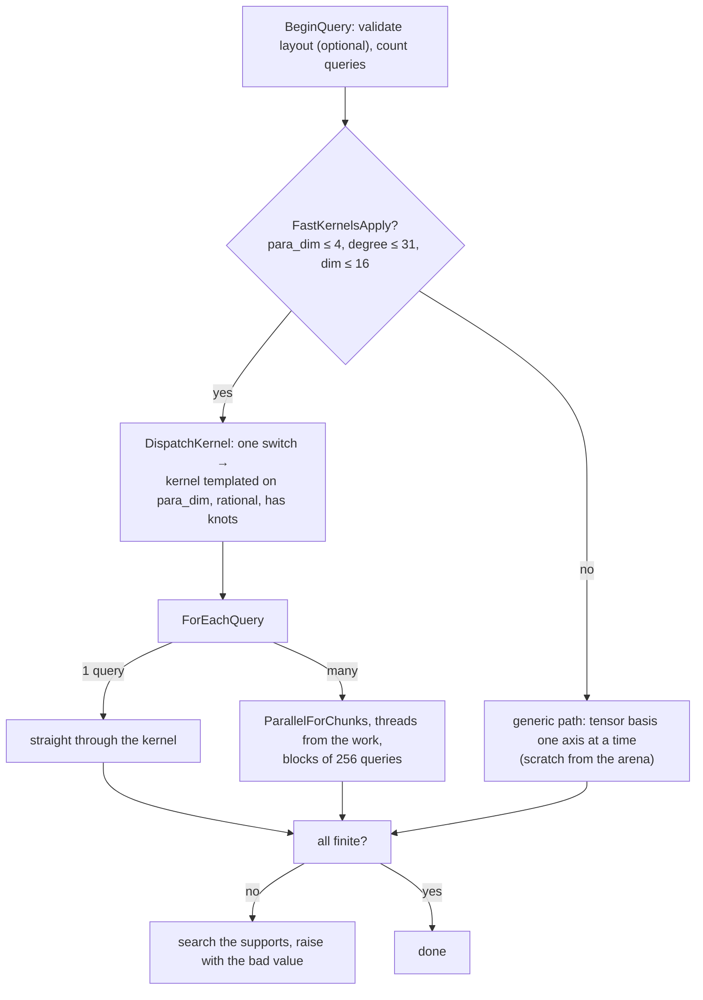

Per query, inside a fast kernel: find the span per axis → 1D basis values per
axis on the stack → contract over the `∏(p+1)` supports, reading control
points straight from the view (strides computed inline). Bezier and BSpline
differ only in the 1D basis.

The single-query path matters because the hierarchy and the proximity search
call the tensor queries point by point.

## 9. Changing the basis: AxisMap

Knot insertion, degree elevation, Bezier extraction, uniform refinement and a
hierarchy level's two-scale relation are the same thing: new coefficients =
banded matrix × old coefficients, one axis at a time. The matrix depends on
knots only.

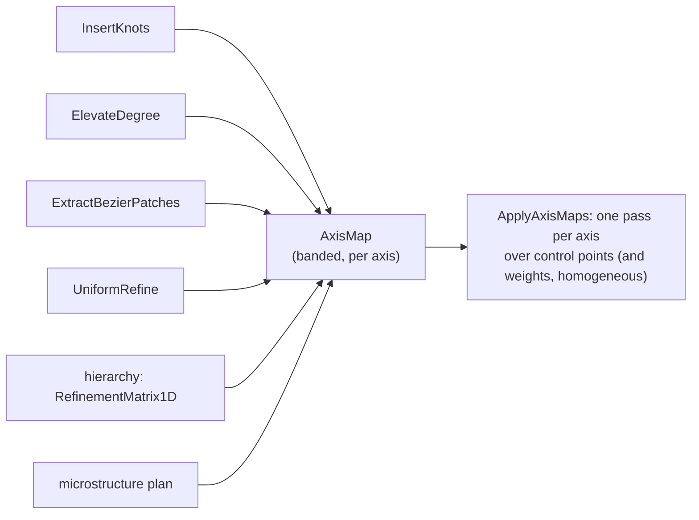

Insertion maps are built by Boehm's rule on the rows of the map, so the
entries are convex combinations with exact zeros.

## 10. Hierarchical splines (HB / THB)

### What is stored

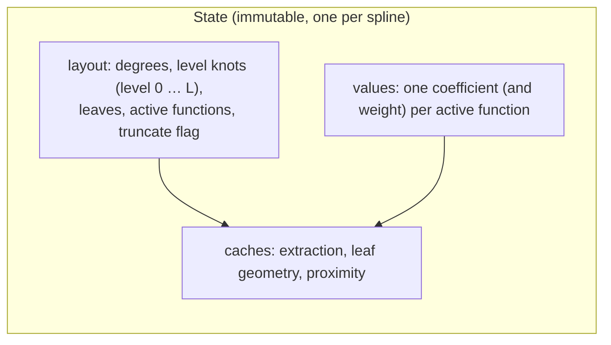

- **Leaves**: the cells of the mesh, each at one level. They partition the
  domain. Stored as a sorted array of 64-bit keys,
  `key = (morton index << level_bits) | level`. Morton order makes the
  children of a cell a contiguous key range.
- **Active functions**: sorted keys `(level << index_bits) | tensor index`.
  Derived from the leaves (`BuildActiveSets`); the same for HB and THB.
- Lookup is binary search in a sorted array. No tree, no pointers.

### Extraction: turn every leaf into a small B-spline

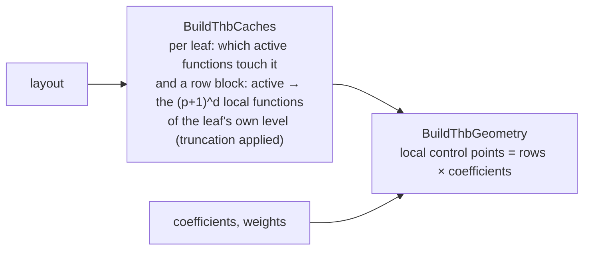

The rows come from the two-scale relation between levels (an `AxisMap` per
axis). For THB, truncation drops the part of a coarse function that finer
active functions already represent; extraction stops where truncation ends
it. Extraction depends on layout only, geometry on layout and values, so they
are separate caches.

### A query

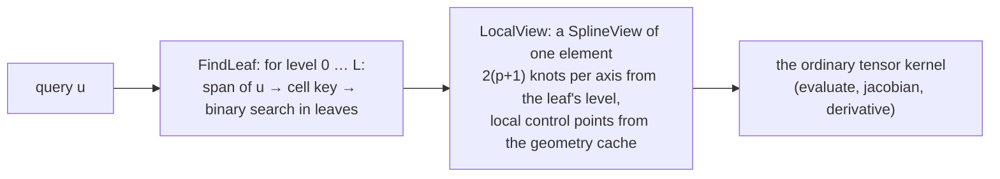

So the hierarchy has no evaluation code of its own: after the leaf lookup it
is a B-spline query. Basis queries map the local values back through the
extraction rows to the active functions. The loop is a `ParallelForScratch`;
each point takes the single-query path of section 8.

### Refine and coarsen

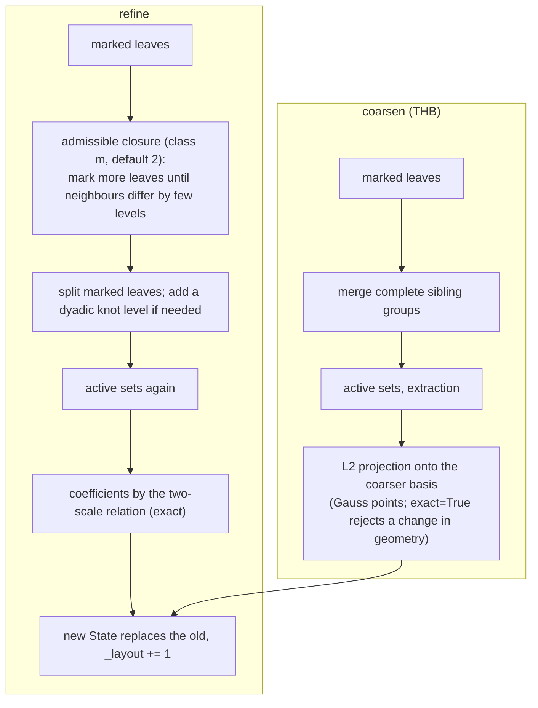

Calls and NumPy views hold the State they started with, so a refine in
another thread cannot free memory in use.

## 11. Where to look

| topic | files |
|---|---|
| views and data | `core/model/spline_view.hpp`, `spline_data.hpp`, `axis_array.hpp` |
| buffers, arena, workspace | `core/memory/buffer.hpp`, `dynamic_buffer.hpp`, `memory_arena.hpp`, `workspace.hpp` |
| threads | `core/concurrency/thread_pool.*`, `parallel_for.hpp`, `team.hpp` |
| queries | `core/queries/*.cpp`, `detail/kernels.hpp` (fast), `detail/query_helpers.hpp` (shared head, loop, generic) |
| basis change | `core/manipulation/axis_map.*` |
| Bezier algebra, compose | `core/bezier/*` |
| hierarchy | `core/hierarchy/key.hpp`, `hierarchy.cpp` (active sets, extraction), `queries.cpp`, `refine.cpp`, `coarsen.cpp` |
| Python boundary | `bindings/python/nb_common.hpp` (`NativeSpline`, `SplineArrays`), `nb_spline.cpp` (types, results), `nb_hierarchy.cpp` (State) |
| Python classes | `splinepy/spline.py`, `hierarchy.py`, `multipatch.py` |

A way to keep the map current: each section above names the two or three
functions that carry the idea. If a change touches one of them, this file is
the place to update.
